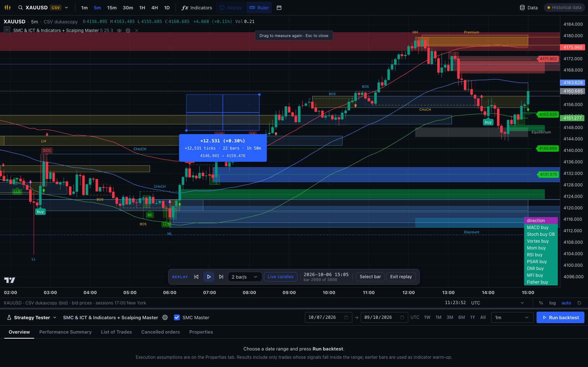

# Ruler and replay timeframe update

13 October 2026.

The top toolbar now includes **Ruler**, beside Replay. Drag between two points or click start/end.
The result displays signed price change, percentage from the start price, ticks at feed precision,
bar intervals, elapsed time, and the endpoint prices. Blue indicates an upward price measurement;
red indicates downward. Shift enables temporary measurement; releasing Shift clears it. Esc exits;
Delete/Backspace clears the current measurement. Measurement uses chart price conversions, including
log/% scale modes, and actual candle columns rather than dividing wall-clock time by bar duration.

Replay previously reset to off on every timeframe change. It now preserves an absolute completed-data
cutoff independently of the new timeframe's last visible candle open. Changing timeframe pauses playback
and loads a historical window around that cutoff. A larger candle's completed OHLC is hidden until its
close is within the cutoff; returning to the original timeframe restores its original bar when no step
has advanced the clock. No provisional partial higher-timeframe candle is reconstructed by a switch.

Forward candle paging was added to the existing API to let replay continue past its initial historical
window. Fetched future bars remain hidden until replay advances. Exit replay loads the latest data
when the bounded historical window does not reach it. Superseded requests cannot overwrite a newer
timeframe load. Indicator requests use the controller's current completed replay cursor.

Validation:

- Frontend: 32 tests passed, including ruler arithmetic/session gaps, replay cutoff mapping/DST,
  controller loading/request races, hidden forward pages, and exit-to-latest behavior.
- Backend: 111 tests passed, including sequential forward API paging.
- Frontend production build and lint passed.
- Browser: picked 6 October 2026 at replay clock 15:05 UTC; switched 5m → 1m → 1H → 4H → 1D → 5m.
  The clock stayed at 15:05 and replay stayed active. Original 5m last visible bar: 15:00.
- Browser: step forward advanced the cutoff to 15:10; step back restored 15:05.
- Browser: upward/downward drag, click-to-click, Shift measurement/release, Esc, and exit replay checked.
  A 1m indicator request ended at 15:04, within the 15:05 cutoff. Exit restored the stored latest candle.
- Browser: log and percentage-scale measurements matched the chart's inverse price coordinates;
  Delete cleared each measurement, and Esc deselected the toolbar tool.
- Visual inspection: ruler rectangle, result label, toolbar placement, and replay controls verified.

These checks used the project's stored historical CSV feed. They do not establish live-provider parity
with every TradingView behavior. Indicator detection rules were not changed.

